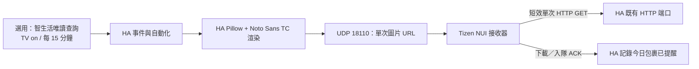

# Samsung TV notifications for Home Assistant

在 **Samsung Tizen 電視原生 App 上方**顯示短訊息，不需要 Android 電視盒，也不必切換成投放畫面。

HA 負責文字轉 PNG、傳送與自動化；電視只執行最小原生 NUI 接收器。正式運作**不依賴 Mac、PC 常駐程式或額外 HA add-on**。另附智生活包裹通知整合：電視開著時每 15 分鐘查詢，同一未領包裹每天提醒一次。


> 上圖是通知素材預覽，不是電視實拍。這是社群實驗專案，不是 Samsung／Smartdaily 官方產品。已在一台 Samsung Q60D 75 吋、Tizen 9.0、HA Core 2025.7.1 / Python 3.13 驗證；其他機型與韌體未保證相容。

## 已確認的效果

- 右上角 **480 × 83** 通知，約 **7 秒**後自動消失。
- 使用者實機確認通知不會中斷當時播放的節目，遙控器仍可操作。
- 完整 **HA → 電視**路徑已實機驗收；不是只看到 HTTP 200 或 UDP ACK。
- 可選擇在電視已開機、接收器未執行時，透過區網 REST 啟動固定接收器；不會喚醒電視。
- 尚未做整台 TV 電源重啟後、各影音 App／HDMI／DRM 組合的全面測試。

## 專案內容

| 路徑 | 用途 |
| --- | --- |
| [`tv/`](tv/) | Tizen .NET / NUI 接收器，版本 1.0.1，GPL-3.0 |
| [`custom_components/samsung_nui_notify/`](custom_components/samsung_nui_notify/) | HA 本機文字渲染、一次性圖片與 UDP 傳送，MIT |
| [`custom_components/smartdaily_postal_ha/`](custom_components/smartdaily_postal_ha/) | 可選：智生活唯讀包裹整合，MIT |
| [`examples/smartdaily-parcels.yaml`](examples/smartdaily-parcels.yaml) | 可選：包裹通知、成功後每日去重的 HA 自動化 |
| [`tests/`](tests/) | 僅 localhost / mock 的離線測試 |

## 安裝順序

1. **先安裝電視接收器**：依 [`tv/README.md`](tv/README.md) 建置，使用**自己的 Samsung 憑證與電視 DUID**簽章後安裝。不是 APK，也不是商店一鍵安裝；本專案不公開任何簽章憑證或裝置專屬安裝包。
2. **安裝 HA 通知整合**：依 [`docs/home-assistant.md`](docs/home-assistant.md)，複製 `custom_components/samsung_nui_notify`，重啟 HA Core 一次，再透過設定介面新增整合。保留 `fonts/` 及授權檔。
3. 在 HA「開發者工具 → 動作」測試：

   ```yaml
   action: samsung_nui_notify.send
   data:
     message: "你有包裹通知"
   ```

4. 需要智生活包裹提醒，再依 [`docs/smartdaily.md`](docs/smartdaily.md) 安裝第二個整合及自動化。

這是手動安裝的多元件專案，**目前沒有宣稱 HACS 一鍵安裝相容**。請先備份 HA 設定；只需重啟 Core 載入自訂整合，不需要升級 HA、重啟主機或改路由器轉發。

## 運作方式



區網需允許 HA → TV TCP 8001 / UDP 18110，及 TV → HA 既有 plain HTTP 端口（通常 TCP 8123）。HA 與 TV 要能直接互通；不使用外部 HTTPS 反向代理來傳圖片。參閱[安全模型](SECURITY.md)與[協定／限制](docs/protocol.md)。不要把 TV 控制埠或 UDP 接收埠轉發到外網。

## 開發與驗證

Python 3.13+，建議在獨立虛擬環境執行：

```sh
python -m venv .venv
. .venv/bin/activate
python -m pip install -r requirements-test.txt
python -m unittest discover -s tests/smartdaily -v
python tests/test_sender_local.py
python tests/test_config_schema.py
python scripts/check-public-tree.py
```

測試不使用帳密、不連真實 HA／電視／智生活。實機與離線驗證的界線見 [`docs/verification.md`](docs/verification.md)。

## English overview

A small native Tizen NUI receiver displays an unobtrusive, auto-dismissed overlay above a Samsung TV's native apps. Home Assistant renders the message locally using Pillow and the bundled OFL-licensed Noto Sans TC font, serves a short-lived single-use image, and sends a UDP request. No always-on computer bridge is required.

Tested on one Q60D / Tizen 9.0 with HA Core 2025.7.1. Receiver signing is device-specific: build it and use your own Samsung certificate. This is not an Android APK, an official Samsung notification API, or a universal compatibility promise. The optional Smartdaily integration polls only while the TV reports on, every 900 seconds; unclaimed package IDs are acknowledged once per Asia/Taipei date after successful transfer, and become due again the next day.

## 授權與來源

此倉庫為多授權集合；根目錄 GPL-3.0 適用未另標示的檔案。接收器基於 [als7294/overscreen](https://github.com/als7294/overscreen) 的最小 `tvoverlay/`，保留 GPL-3.0；智生活整合基於 [andyching168/Smartdaily_Postal_HA](https://github.com/andyching168/Smartdaily_Postal_HA)，保留 MIT；新 HA sender 為 MIT，字體為 SIL OFL 1.1。精確來源、範圍與修改見 [`THIRD_PARTY_NOTICES.md`](THIRD_PARTY_NOTICES.md)。
